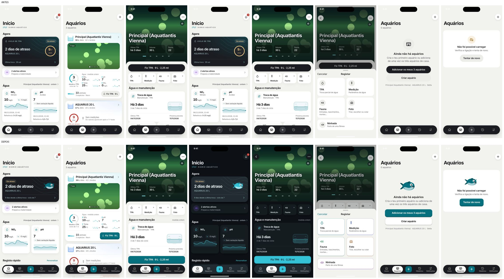

# Revisão de design e motion — aquario-app

Ferramentas: Impeccable (`teach`, `audit`, `critique`, detetor) e skills de Emil Kowalski
(`review-animations`, `improve-animations`, `apple-design`, `mobile-native`, `ask-sonner`).
Alvo: iPhone 16 Pro Max, 440×956, PWA standalone. Contexto do produto: [PRODUCT.md](../PRODUCT.md).
Capturas e vídeos: `reviews/2026-11-07/design-antes/` e `design-depois/` (`iphone-16-pro-max/`).

Decisões do dono (2026-11-07): modo escuro automático volta; personalidade expressiva à Duolingo
**em toda a app**; mascote-peixe original a criar.

## 1. Auditoria (ciclo 0, antes de mexer em código)

**Método:** `critique` com duas avaliações isoladas em sub-agentes — A (revisão de design) e B (detetor CLI + overlay no browser + axe) —, `audit` técnico e auditoria de motion com `review-animations` / `improve-animations` (Emil).

### Notas
| Medida | Resultado |
|---|---|
| Heurísticas de Nielsen (critique A) | **26/40** — Aceitável |
| Audit técnico (a11y 3 · perf 3 · tema 1 · responsivo 3 · integridade 2) | **12/20** — Aceitável |
| Detetor (CLI + browser) | 1 advisory (`--ease-pop` com overshoot) · `radial-spotlight-glow` e `ai-color-palette` no hero do Início · texto a 10 px · 5 `nested-cards` (falso positivo: a folha sobre o hero) |
| axe-core (10 rotas, WCAG 2.2 AA) | 0 sérias/críticas · `region` (moderada) em 10/10 rotas · 64 contrastes por verificar sobre fotos/gradientes |
| CLS | 0,000 em todas as rotas |
| Alvos < 44 px | 0 |
| Texto < 13 px | 103 nós (Início 38 · Aquários 30 · Detalhe 28); 1× 10 px |
| Modo escuro | **inexistente**: 0 regras `prefers-color-scheme`; capturas claro/escuro iguais (0,00 % de diferença) |
| Cores fora dos tokens | 35 em `.tsx` + 25 em CSS locais (mare, kit, widget) |

**Veredito de especificidade:** o conteúdo é muito do domínio (TPA, AMTRA, AGERE, maternidade), mas a forma é genérica — off-white, carvão, cartões com sombra, ícones em círculos — e serve igual a uma app de finanças. Contradiz o compromisso de marca (expressiva, à Duolingo, com mascote).

### O que funciona (manter)
- "Fiz TPA" num toque com litros e dose pelo volume útil e "Anular".
- Sheets de registo: Guardar fixo, predefinições em chips, unidades, teclado certo (revisão anterior).
- Histórico agrupado por dia com os parâmetros em chips.
- Base técnica: teclado/visualViewport, safe areas, scroll, PWA, CLS 0, alvos ≥ 44 px.

### Motion (Emil: `review-animations`)
| # | Achado | Regra | Prioridade |
|---|---|---|---|
| M1 | Toasts com keyframes próprios (não interrompíveis, sem swipe, fecham com qualquer toque) | interruptibilidade; Sonner | P1 |
| M2 | O momento de maior mérito (TPA feita) acaba num toast; não há celebração (pico/fim) | delight em ações raras/significativas | P1 |
| M3 | Saídas com `--ease-in` (tab bar, toasts, visualizador, fade das view transitions) | "nunca ease-in em UI": saídas rápidas com ease-out | P2 |
| M4 | Overshoot (`--ease-pop`) usado em 12 elementos genéricos (imagens, badges) | bounce só em interações lúdicas/celebrações | P2 |
| M5 | Brilho radial animado/decorativo no hero do Início | decoração sem propósito | P2 |
| M6 | Durações/curvas literais no kit (`.34s`, `.38s`, `cubic-bezier` repetida) e em `globals.css` | tokens únicos | P3 |
| M7 | Números que mudam (dias, contagens) saltam sem transição | continuidade de estado | P3 |
| ✓ | Pressão `scale(.97)` 120 ms, disco da navegação 280 ms ease-out, sheets vaul com curva de gaveta, `prefers-reduced-motion` tratado | — | manter |

### Relatório priorizado (impacto × esforço)
| Prio | Problema | Onde | Correção | Comando | Impacto | Esforço |
|---|---|---|---|---|---|---|
| **P1** | Sem modo escuro | `globals.css`, `layout.tsx`, cores literais em `ciclo-tpa`, `hero-aquario`, `screen`, CSS locais | Tokens claro/escuro, `themeColor` por esquema, literais → tokens | `colorize`, `adapt` | Alto | M |
| **P1** | Personalidade ausente (carvão sóbrio vs. "Duolingo aquático") | `button.tsx`, tokens, Início, estados vazios | Cor de marca aquática saturada nas ações; botões com relevo que afundam; celebrações; mascote | `bolder`, `delight` | Alto | M–L |
| **P1** | Ação principal fora do terço inferior (Fiz TPA a 29–47 % da altura) | `aquario/detalhe.tsx` | "Fiz TPA" flutuante acima da navegação no detalhe | `layout` | Alto | S |
| **P1** | Toasts sem swipe/empilhamento, fecham com toque acidental | `ui/toasts.tsx`, `lib/toast.ts` | Sonner (skill `ask-sonner`), mantendo a API `toast()` | `animate` | Médio | S |
| **P2** | Escala tipográfica fragmentada (16 tamanhos, 103 nós < 13 px, px fixos) | 17 ficheiros + kit | Papéis iOS em tokens (34/22/17/15/13/12) em rem; nada < 12 px | `typeset` | Médio | M |
| **P2** | Cartões do kit densos (≈28 dados, data repetida 4×, referência sempre visível) | `agua-manutencao.tsx`, kit | Variante compacta: data uma vez, referência só fora da faixa, fora da faixa em destaque | `distill` | Médio | S–M |
| **P2** | Navegação só com ícones (reconhecer vs. recordar) | `tab-bar.tsx` | Rótulos curtos sob os ícones, como no iOS | `clarify` | Médio | S |
| **P2** | Motion M3–M5 | `globals.css`, `mare.css` | Saídas ease-out curtas; overshoot só em celebrações; sem brilho decorativo | `animate`, `quieter` | Médio | S |
| **P3** | Iconografia genérica (ícone em círculo; peixe para 3 conceitos; sino para cortes de luz) | Registar, alertas, histórico | Glifos próprios (raio, ninhada) e menos círculos | `polish` | Baixo | S |
| **P3** | axe `region`: título fora de landmarks | `screen.tsx` | Título dentro de `<header>` | `audit` | Baixo | S |
| **P3** | Literais de motion (M6), números a saltar (M7) | kit, `globals.css` | Tokens; transição nos números | `polish` | Baixo | S |

## 2. Ciclos de correção

### Ciclo 1 — fundação expressiva (`78eb10c`)
| Prioridade | O que mudou | Ficheiros |
|---|---|---|
| P1 escuro | Tokens claro/escuro automáticos (fundo, superfícies, texto, marca, estados, gráficos, sombras), `themeColor` por esquema, CSS do Início e do kit sem cores presas ao claro | `globals.css`, `layout.tsx`, `mare.css` |
| P1 personalidade | Cor de marca aquática (`--marca`) nas ações; **botões com relevo** que afundam ao toque (primário/secundário/perigo); "+" da navegação com relevo | `globals.css`, `ui/button.tsx`, `shell/tab-bar.tsx` |
| P1 mascote | Peixinho original em SVG (contente · festa · preocupado), cores dos tokens: hero do Início como **indicador de estado**, estados vazios e de erro | `mascote/*`, `home/ciclo-tpa.tsx`, `ui/estado-erro.tsx`, páginas |
| P1 celebração | "TPA feita!" — mascote em festa com bolhas, 1,8 s, não bloqueante, anunciada a leitores de ecrã | `lib/celebrar.ts`, `mascote/celebracao.tsx`, `lib/fiz-tpa.ts` |
| P1 uma mão | "Fiz TPA" flutuante no terço inferior do Detalhe (esconde-se com o teclado) | `shell/screen.tsx`, `aquario/detalhe.tsx` |
| P1 toasts | **Sonner** headless (swipe, em lista, interrompível); toque já não fecha; "Anular" sempre visível; selo SVG em vez de ✓ | `ui/toasts.tsx`, `lib/toast.ts`, `layout.tsx` |
| P2 tipografia | Papéis iOS em rem com Dynamic Type (`font: -apple-system-body`): 236 tamanhos soltos → 9 papéis; nada < 12 px | `globals.css` + 40 ficheiros |
| P2 densidade | Variante `compacto` do `ParametroAgua` (kit): data uma vez no título da secção, referência só fora da faixa, cartão fora da faixa destacado | kit, `agua-manutencao.tsx`, `ultima-medicao.tsx` |
| P2 navegação | Rótulos sob os ícones; pastilha ativa desliza (só transform) | `tab-bar.tsx`, `globals.css` |
| P2 motion | Saídas ease-out 160 ms (sem ease-in); overshoot só em celebrações; `pop-in` sem bounce e a partir de 0,92; sem brilho decorativo; literais do kit → tokens | `globals.css`, kit, `mare.css` |
| P3 a11y | Título do ecrã dentro de um landmark (axe `region`); contexto "Ciclo de TPA" para o VoiceOver | `screen.tsx`, `ciclo-tpa.tsx` |

Testes: suite móvel 289 ✓; três testes ajustados à estrutura nova (seletor do toque longo, espera pela navegação no swipe, nome acessível do hero) — sem regressões de teclado, safe areas, scroll ou PWA.

### Ciclo 2 — re-critique (A: 31/40 · B: sem P0/P1) e correções
Re-avaliação com as duas avaliações isoladas sobre o ciclo 1. Encontraram 2 P1 (véu claro por baixo da navegação no escuro; branco sobre vermelho no escuro a 2,7:1) e vários P2/P3, todos tratados:

| Prioridade | O que mudou |
|---|---|
| P1 | Véu da navegação feito de `--bg` (já não fica claro no escuro); ação flutuante por cima dele |
| P1 | `--danger-solido` / `--sobre-ok`: texto sobre vermelho e verde ≥ 4,5:1 nos dois temas (toast de erro, badges, botão de perigo, visto das férias) |
| P2 | Contrastes no limite no claro (4,3–4,48:1) → marca `#07707f`, perigo `#b02f29`, texto sobre `accent-soft` em `accent-forte` (10 sítios) |
| P2 | Ações de criar de Produtos, Desejos e Férias no terço inferior (Aquários e Fontes mantêm o "+" do header: criar é raro) |
| P2 | Personalidade nos ecrãs secundários: mascote nos vazios de Desejos e Férias; celebração ao completar a checklist das férias; aviso de stock só depois da celebração da TPA |
| P2 | Header compacto mais opaco (0,94) — o conteúdo já não se lê através do título |
| P3 | Segmento ativo mais claro que a calha no escuro; pastilha da navegação mais larga; expressões da mascote mais distintas; ícone de raio para os cortes de luz; cartões de escolha do Registar com relevo e tons por tipo (tokens `--tom-*`, partilhados com o Início) |

Decisões registadas: a sheet da TPA não vem pré-preenchida (o "Fiz TPA" já é o caminho de um toque; um valor pré-preenchido arriscava registos por engano). `bounce-easing` do detetor fica como aviso intencional (`--mola-suave`/`--mola-festa`, só em botões com relevo, mascote e celebrações). `hard-offset-shadow` nos botões é a direção pedida (relevo à Duolingo).

## 3. Resultado

| Medida | Antes | Depois |
|---|---|---|
| Heurísticas de Nielsen (critique A) | 26/40 | **31/40** no ciclo 2, antes das correções desse ciclo |
| Audit técnico | 12/20 | **17/20** (a11y 4 · perf 3 · tema 4 · responsivo 3 · integridade 3) |
| Problemas P0/P1 abertos | 4 P1 | **0** |
| axe (8 rotas × claro/escuro × WebKit/Chromium) | `region` em 10/10 rotas | **0 violações** |
| Texto < 12 px | 1 (10 px) + 40 de 11–12 px | **0** < 12 px; papéis iOS em rem |
| Modo escuro | inexistente | automático, com tokens próprios |
| Suite móvel | 289 | **297 ✓** (+ axe em escuro) |
| Detetor Impeccable | 1 aviso | 2 avisos intencionais (molas) |

Antes/depois (iPhone 16 Pro Max, 440×956): 

Capturas completas: `reviews/2026-11-07/design-antes/` e `reviews/2026-11-07/design-depois/` (claro, escuro, scroll, sheets, estados); vídeos em `…/videos/` (Fiz TPA + navegação + registo; tabs).

Ficam para depois (P3): `nested-cards` no Detalhe (ciclo de TPA + parâmetros dentro da secção), violeta dos alertas de ninhada sem token, números que mudam sem transição.

## 4. Para confirmar no iPhone real (5 pontos)
1. **Tema escuro**: muda o iPhone para escuro com a app aberta — fundo, cartões, navegação, sheets e a barra de estado (cor do tema) acompanham, sem faixas claras.
2. **Botões com relevo**: carrega devagar no "Fiz TPA", no "Guardar" e no "+" da navegação — afundam enquanto o dedo está em baixo e voltam com uma pequena mola ao largar.
3. **Celebração**: faz uma TPA com "Fiz TPA" (e anula a seguir) — a mascote aparece a festejar ~2 s, sente-se a vibração de sucesso, e o toast com "Anular" fica visível e pode ser arrastado para o lado.
4. **Uma mão**: no detalhe de um aquário, o "Fiz TPA" está no fundo, ao alcance do polegar, acima da navegação, e desaparece quando abres o teclado numa sheet.
5. **Tamanho do texto**: em Definições → Acessibilidade → Tamanho do texto, aumenta um ou dois níveis — a app acompanha (Dynamic Type) sem cortar títulos nem rótulos da navegação.

